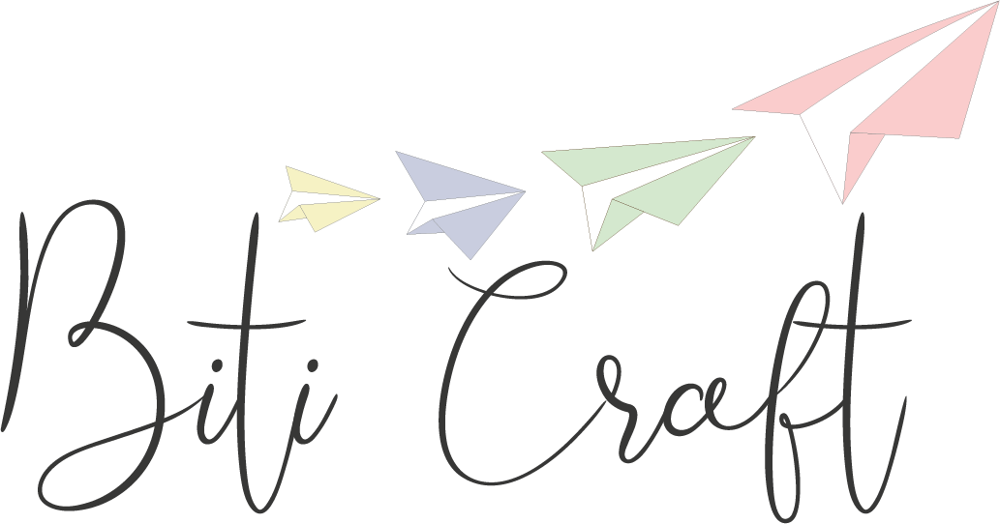

# BitiCraft



BitiCraft crea papelería creativa y diseños personalizados para eventos. Conocé el proyecto en [biticraft.com](https://biticraft.com).

## El sitio

El sitio presenta la marca, sus servicios de papelería física, digital y funcional, e información para conocer el proyecto. Incluye las secciones de inicio, servicios y contacto para enviar consultas sobre ideas y trabajos personalizados.

## Tecnologías

- Next.js con App Router
- React y TypeScript
- CSS Modules

## Estructura

- `.github/workflows/`: automatizaciones de calidad e integración continua.
- `public/`: logo y otros recursos estáticos.
- `src/app/`: páginas, layouts y acciones del sitio; incluye inicio, servicios y contacto.
- `src/components/`: navegación, pie de página, secciones y componentes de interfaz reutilizables.

## Requisitos y desarrollo local

Requisitos: Node.js 24 y npm.

```bash
npm ci
cp .env.example .env.local
npm run dev
```

La aplicación queda disponible en `http://localhost:3000`. Completá la configuración local en `.env.local` y no compartas ese archivo.

## Validación y CI

Ejecutá estos scripts para revisar el proyecto y generar la compilación:

```bash
npm run lint
npm run typecheck
npm run build
```

GitHub Actions instala las dependencias y ejecuta estas tres validaciones en cambios a `main` y `dev`, incluidos los pull requests dirigidos a esas ramas.

## Formulario de contacto

El formulario permite enviar consultas por correo mediante Nodemailer y utiliza Cloudflare Turnstile para la verificación.

## Diseño y desarrollo

Sitio web diseñado y desarrollado por [Nico Kaminski](https://nicokaminski.com).
